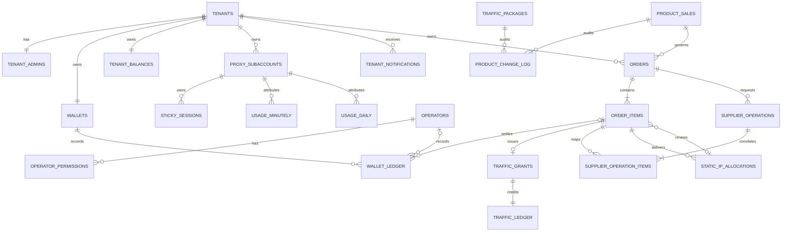

# Proxy 首版全局数据模型、状态机与事务边界

**状态：设计已确认** · [设计任务 #37](https://github.com/DuanJinTaoToday/proxy/issues/37) · [首版 Spec #36](https://github.com/DuanJinTaoToday/proxy/issues/36)

以[首版 Spec](proxy-first-release-spec.md)和[差异审计](../../product/proxy-first-release-gap-audit.md)为依据。下文表名、状态值与处理顺序为已确认的设计基线。首版从空库初始化。控制面的业务写入共用一个 PostgreSQL 数据库和事务入口，供开户、流量购买、计量及静态结算使用。网关文件与本地确认偏移继续由网关维护，皇冠和悟空调用在数据库事务之外执行。

## 实体关系

采购订单明细可以按数量交付多个 IP。续费订单则每个 IP 一条明细，通过稳定的分配 ID 引用已交付 IP。一次供应商请求可以关联多条续费明细，便于支持皇冠批量逐项确认或单 IP 串行两条路径。网关、审计和水位表的键见下文。

## 数据字典

金额暂按人民币分存为整数，采购成本与面向客户的价格分开记。字节数为整数，1 GB = 1,000,000,000 字节。时间点存带时区时间戳，计量日按 `Asia/Shanghai`。租户范围内的跨表引用使用复合外键或等效数据库约束验证归属，应用同时从认证身份取租户。以下唯一键与锁承担并发下的约束，UI 校验只用于反馈。

| 表 | 关键字段与约束 |
| --- | --- |
| `tenants`、`tenant_admins` | `tenants.id` 为主键，`primary_account_name` 全局唯一且固定。管理员 `tenant_id` 为主外键，`phone_e164` 全局唯一，带和不带 +86 归一。存密码摘要、重置时间、会话版本。租户与管理员同事务创建，每租户恰好一名。 |
| `operators`、`operator_permissions` | 运营身份独立于客户，运营名唯一，密钥或密码仅存摘要。权限表主键 `(operator_id, permission)`。只读权限和计费写权限分开。重置凭据记录运营身份与时间。 |
| `proxy_subaccounts` | 稳定 `client_id` 主键，`tenant_id` 外键，唯一 `(tenant_id, name)`。名称固定，存状态、备注、累计实扣字节、可空累计上限、凭据版本。名称、密码遵从 Spec。锁租户行后计数并插入，启用和禁用合计最多 10 个。密码存供认证使用的校验值及供授权查看使用的加密值。 |
| `sticky_sessions` | 主键 `(client_id, session_key)`，默认会话用独立保留键。存会话代次、供应商账号引用、上游 SID、已选时长、首次成功时间、失效时间、建立占用期限。通过唯一约束确保同一供应商账号的当前 SID 不冲突。网关本地可缓存已确认映射，创建和换代由共享状态协调。 |
| `tenant_balances` | `tenant_id` 主外键；`available_bytes` 有符号；可空低余额阈值、当前低余额周期编号、最近入库时间与状态版本。欠费为 `max(0, -available_bytes)`；准入用严格大于 0。 |
| `traffic_grants`、`traffic_ledger` | 流量授予 `id` 主键，订单明细 ID 唯一，存购买字节、抵欠字节、剩余字节及到账时间。授予长期有效。额度流水每笔授予一条，存到账总字节、抵欠字节和变动前后余额。消耗依据用量聚合，查询时可复核累计扣减。 |
| `usage_minutely`、`usage_daily` | 按租户、网关、子账号、日期及分钟（仅分钟表）聚合。主键含这些维度，子账号与租户组合引用子账号表，网关引用实例表。存计费字节、可用于内部诊断的方向字节、记录数、最近入库时间。首版只有真实隧道来源。 |
| `tenant_notifications` | 主键 `id`，租户外键，唯一 `(tenant_id, kind, subject_key, occurrence)`。低流量按低余额周期去重，静态到期按分配 ID 与到期时间去重。记录创建、可选阅读时间，账户概览只展示仍有效的通知。 |
| `wallets`、`wallet_ledger` | 钱包以 `tenant_id` 为主外键，存非负可用金额。流水只追加，含序号、种类、增减金额、前后余额、租户、时间和原业务引用。运营充值含操作人和原因；订单变动含订单明细。以资金事件的业务键唯一，退款关联原预扣。 |
| `product_sales`、`traffic_packages`、`product_change_log` | 开售表以商品类型为主键，初始关闭。套餐主键稳定，存容量字节、价格、是否上架、配置版本。变更日志关联运营、目标、时间和旧值、新值。静态报价由皇冠提供，最终客户确认价以成交快照持久化。 |
| `orders`、`order_items` | 订单含租户、类型、创建者、创建时间及客户请求标识，唯一 `(tenant_id, order_type, request_key)`，存请求摘要以防同键不同载荷。明细含锁定容量或规格、单价、数量、原到期时间（续费）、交付/续费数量、结清数量及状态。续费以分配 ID 做未终结明细唯一约束。外部状态归并到明细，订单状态由明细汇总。 |
| `static_ip_allocations` | 主键 `id`，租户和购买明细外键，存供应商账号、采购明细关联、代理地址端口、加密账密、交付时间、皇冠到期时间。按已验证的供应商交付标识唯一入账。客户授权按分配 ID 与租户判断。IP 地址不能单独作为永久标识。 |
| `supplier_operations`、`supplier_operation_items` | 操作主键及平台内部唯一发送标识，关联平台订单、供应商账号、业务类型、请求状态、供应商订单引用、核实结果与时间。明细关联平台明细、供应商明细引用和处理证据，按供应商语义约束去重，避免把未知响应合并成成功。保留运营接手、关闭和后到结果的处理记录。 |

客户登录密码与运营密码用带独立盐的慢哈希。子账号可查看密码是产品要求，取回所需密文使用平台管理密钥和版本做认证加密，网关认证同步仅携带校验所需数据。静态连接凭据和供应商密钥按用途隔离。日志、通知、审计样例与异常记录避免保存明文凭据或未脱敏供应商响应。

## 状态与不变量

### 身份、流量和会话

- 注册成功后，租户、管理员、钱包、流量余额同时可见，两种余额都是 0。失败整体回滚。密码重置后按会话版本使旧会话失效，运营核实过程由线下完成。
- 子账号在启用、禁用之间切换，名称、clientID、历史用量不变。新连接要求账号启用、租户余额大于 0，且累计用量严格低于已设上限。新密码与启停在网关收到有效更新后生效，旧连接照常计量。缓存有效期与上报恢复追平沿用[认证可用性约定](../../adr/0005-proxy-auth-availability.md)。
- 粘性会话从未建立进入建立中，再由首次成功进入有效期。失败占用可以释放，过期可开新代次。每个会话键同一时刻只允许一个首次建立占用，成功回写须带代次和占用标识。到期只影响新连接；旧连接使用原出口。时长从首次成功起算，有效期内重连沿用锁定值，显式不同值拒绝。失联时可使用仍有效的已确认映射和认证快照，新建或换代须取得权威状态。时长单位、边界与供应商 SID 安全回收窗口待 [#40](https://github.com/DuanJinTaoToday/proxy/issues/40) 联调。
- 流量余额恒等于总到账字节减累计实扣字节。入账先抵欠，剩余形成可用授予。正常扣减按已入账授予的顺序消耗，超出当前授予部分形成欠费。晚到采样按其原日期归集，使用当前写入事务可用余额完成扣减，无过期授予重开。负余额和上限不阻止已建立连接的采样入库。
- 低余额从超过阈值进入小于或等于阈值时生成一个周期的通知，回到阈值以上重新武装。首次配置时若已低于或等于阈值，立即生成本轮提醒；读取或重放不重复创建。

### 商品、钱包和订单

- 商品开售以两个独立状态控制，开启前由计费运营确认对应验收与报价。套餐下架只影响新购。动态订单一次提交买一份，以容量和总价快照成交。钱包余额不足提示差额，事务不产生待支付单。
- 静态资金采用**提交时钱包预扣，按结果确认实扣或回退差额**。预扣实际减少可用金额，实扣确认只更新明细的结算额，失败或少交用唯一退款事件返还钱包。每条静态明细始终满足 `预扣 = 已确认实扣 + 已退款 + 待结算`，待结算归零才可关单。钱包流水变动额之和等于当前可用金额。采购成本单列，不参与客户钱包平衡。
- 静态明细提交后进入待处理，发往皇冠后可获得成功、明确失败或待核实。购买部分交付后可继续待核实，每个有效分配即时可用。确认为不交付的剩余数量退回，聚合结果为全成、部分完成或未交付关闭。续费逐条进入成功或失败，父订单展示整体结果。
- 皇冠响应未知先查单。提交满 24 小时仍未知交运营核实，满 72 小时仍未知由运营关单并退回剩余款。人工处理以状态、明细及证据留痕，时间点供运营识别。终态后的迟到成功只入运营证据，已退款的明细不复开、不补扣，也不新增客户交付。
- 静态 IP 可用性以已交付且未到皇冠到期时间判定，正在续费不会提前延长。到期后停止向客户视为可用，保留记录。客户用供应商凭据直连，实际出口停止与恢复依赖皇冠，开售前必须真实验证。到期前提交的续费，确认保号成功才更新同一分配的到期时间，按原到期点核验顺延。旧到期提醒失效，新到期点提前五天提醒一次。

| 状态对象 | 允许的主要转换 |
| --- | --- |
| 钱包购买流量 | 未提交 → 成功。提交失败不形成订单，成功后只按原请求键查询既有结果。 |
| 静态采购明细 | 待发送 → 处理中 ↔ 待核实 → 运营核实（需要时）。处理中或核实中可追加部分交付并保留未结数量，待结算归零后进入全成、部分完成或已关闭。 |
| 静态续费明细 | 待发送 → 处理中 ↔ 待核实 → 运营核实（需要时）；核实同 IP 且到期时间正确后进入成功，明确失败或运营关单进入已关闭。两种终态均解除未终结续费约束。 |
| 供应商操作 | 待发送 → 已认领 → 已确认或结果未知。认领后缺少明确结果时只能查单或人工核实。若能证明上游未受理，是否重发按已联调契约和运营判断处理。订单终结后仍可记录迟到结果。 |

## 事务与并发

每次提交只在 PostgreSQL 内完成可原子提交的本地更新。以唯一键约束注册、提交、授予、退款、供应商交付和提醒去重。请求重试使用原业务键并核对摘要；同键不同载荷拒绝。供应商响应未知时，平台内部去重无法证明上游没执行。

| 业务 | 原子提交与事务外边界 | 重试和并发 |
| --- | --- | --- |
| 开户及子账号 | 开户一次提交租户、管理员、零钱包和零流量账户；子账号创建查租户数量后插入。改密、启停或上限写本身状态并提高版本，提交后供网关刷新。 | 手机号和主账号名由唯一键兜底；子账号名租户内唯一，创建时锁租户，避免并发超过 10 个。 |
| 运营钱包充值 | 核对权限与已确认的租户、金额、原因及预计到账余额，锁钱包行，追加充值流水并更新余额。确认后余额若变化，展示新预计余额并请运营重新确认。 | 运营提交键唯一，重试返回原流水。资金变动按钱包串行。 |
| 购买流量 | 检查商品开售与套餐版本，锁钱包再锁流量账户。一次提交订单快照、钱包扣款、授予、抵欠、额度流水、低余额周期更新和成功状态。 | 同订单键只成交一次，扣款时重新校验可用金额和商品状态。事务中途失败整体回滚。 |
| Recorder 入库 | 校验网关身份和稳定 clientID，锁文件水位后按固定顺序锁相关租户流量账户，再更新子账号累计、授予与余额、聚合、提醒和水位。整段提交后才确认。 | 已确认记录跳过，偏移断层或跨水位拒绝，无法归属等异常留证。归档和晚到补报共用归档水位协调，以原采样日期记账。网关拿到连续确认后才落盘推进。 |
| 静态购买提交 | 事务外复查皇冠报价库存。价格变化或数量不足先返回复核结果。事务内复核本地开售状态、请求快照及钱包可用额，写订单、明细、预扣与待发送操作。 | 锁价不可变。正式发送前独占认领操作记录并提交，再调用皇冠。即使认领后进程退出，仍按结果未知处理和核实，避免盲发第二次。 |
| 静态续费提交 | 事务内锁目标分配，验证到期时间与租户、保存原到期点和锁价，预扣并记录按项可核对的待发送操作。 | 按分配 ID 排序锁定，同一 IP 的未终结续费唯一；可按联调结论映射为一批或多笔串行请求。 |
| 皇冠结果、结算和运营关闭 | 事务内锁业务订单，验证仍可结算的明细。购买将核实的交付写入分配并确认实扣；续费验证同 IP 和原到期点后更新同一分配。失败或关闭剩余时追加退款并更新钱包；同批刷新汇总状态。 | 每项结果以供应商标识或已核实的映射去重。关单与结果写入竞争时以先取得订单锁并提交的状态为准，后到结果留证。迟到旧结果不得覆盖较新到期时间。 |

共享写入遵守固定顺序：商品或订单先于资金类写入，涉及 IP 时先锁订单再按 ID 锁分配，之后锁钱包。购买流量时钱包先于流量；计量只写流量、凭据累计和聚合，不反向获取钱包锁。账号编辑和网关快照读取不得反转该顺序；快照须来自一致视图。跨供应商调用不持有这些锁。

## 现有表处置

以 `00001`–`00006` Goose 迁移实际创建的表为基线。认证配置中的预置客户及多租户成员映射也纳入处置。

| 处置 | 现有表或配置 | 首版安排 |
| --- | --- | --- |
| 复用 | `gateways`、`gateway_tokens` | 复用网关服务身份、令牌范围、轮换和摘要存储。 |
| 复用 | `gateway_boots`、`ingest_cursors`、`usage_archive_state`、`record_anomalies`、`usage_gaps` | 保留启动代次、生命周期、偏移、留证及归档边界。适配新聚合维度时保留 60 天分钟汇总、14 天 Recorder 追查及已有回放约定。 |
| 复用并重绑 | `gateway_auth_references` | 外键改绑稳定的子账号 clientID，保留按网关绑定刷新引用。 |
| 替换 | `proxy_credentials` | 由 `proxy_subaccounts` 承接，改成租户内命名、可查看密码、启停和累计上限，无需迁移旧账密。 |
| 替换 | `tenant_balances`、`traffic_grants`、`balance_ledger` | 保留流量授予及抵欠概念，采用有符号余额、永久套餐授予和 `traffic_ledger`。账号钱包另建表。 |
| 替换 | `usage_minutely`、`usage_daily` | 保留分区和归档设计，聚合键改为租户、网关与子账号，去掉倍率和授予分桶键。 |
| 删除 | `billing_rates`、`tenant_groups`、`tenant_group_members`、`billing_settings` | 计费固定 1:1，租户余额门槛固定为严格大于 0，管理员提醒阈值进入流量账户。 |
| 删除 | `mock_supplier_usage` | 从首版业务 schema 移除。历史内部演示资料可用于追溯。 |
| 替换 | 配置内预置客户、成员关系和运营权限 | 客户身份走开户持久化流程。运营身份及权限按首版库内模型初始化。 |

**从空库初始化。** 后续实现可重做 Goose 初始迁移，先建身份与网关，再建商品、订单和明细，然后建静态分配、供应商记录、账务和用量聚合。订单明细到静态分配的续费外键在两表都建立后加入。最后种入关闭的商品状态及 5 GB、50 GB、200 GB 三档默认套餐。5 GB 档的价格基准由运营配置，50 GB 和 200 GB 档的默认每 GB 单价分别比 5 GB 档低 10% 和 20%。目录就绪及对应商品验收通过后由运营开售。对旧开发库使用独立的新空库或经授权重建测试库，更新生成的 DAO、测试夹具、配置示例及集成测试。验收执行空库迁移和测试数据初始化。旧数据、旧协议及双写不属于本设计。

## 设计审阅与验证

| 场景 | 预期不变量 |
| --- | --- |
| 两个并发注册使用同一手机号的两种写法，两次并发创建第 10 个子账号 | 手机号只生成一个租户和管理员，子账号最终不超过 10 个。 |
| 钱包余额刚够一份，客户重复提交并丢失一次响应 | 一笔订单、一条扣款、一笔授予；重试返回同一订单。 |
| 流量剩 1 字节，旧连接使用 7 字节，补报重复一次，随后购买到账 10 字节 | 实扣和该子账号累计均增加 7，余额先变为 −6，重复补报无变化，到账后余额为 4；满足条件的新连接在同步后恢复。 |
| 购买 5 个 IP，每个 1,000 分，先交 2 个，剩余超时关闭 | 预扣 5,000 分，实扣 2,000 分，退回 3,000 分。后到交付进入运营记录，客户仍结清 2 个。 |
| 两个 IP 批量续费，仅一项确认成功，另一项确认期间到期 | 成功项保留分配 ID 并顺延；另一项保持原到期点，确认成功才恢复，最终失败则退款。父单能对账至每一项。 |
| 两个网关同时为相同子账号与 SID 发起首次连接 | 只有一个有效会话代次和首次成功计时；会话到期后可以重新指定时长，不影响旧连接。 |

单库事务、静态钱包先预扣后差额退款、共享会话登记与初设低余额阈值时的提醒语义均已确认。皇冠的逐项标识、部分交付证据、保号与停恢复由 [#39](https://github.com/DuanJinTaoToday/proxy/issues/39) 验证，悟空参数由 #40 验证。具体接口与序列化契约留给 #38。
