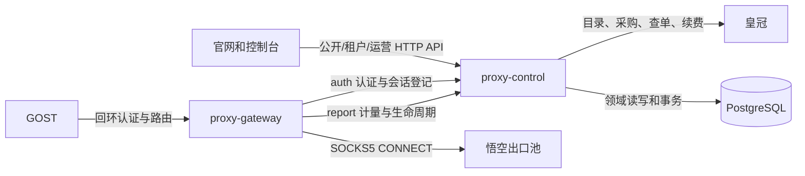

# Proxy 首版模块职责、接口契约与调用时序

**状态：设计已确认** · [设计任务 #38](https://github.com/DuanJinTaoToday/proxy/issues/38)

依据[产品 Spec #36](https://github.com/DuanJinTaoToday/proxy/issues/36)和[已确认的数据模型 #37](proxy-first-release-data-model.md)。文中 RPC、HTTP 路径、消息名与错误码为已确认的契约基线，具体字段和绑定在各业务票落地。跨应用继续使用 Protobuf 定义 HTTP/JSON，控制面各领域在同一进程和 PostgreSQL 事务内调用。

## 职责与调用关系



| 提供方 | 调用方 | 职责和边界 |
| --- | --- | --- |
| 身份与授权 | 官网、控制台、运营、各写入方 | 手机开户、控制台会话、运营权限、人工核实后的重置。以认证身份获得客户租户，运营操作独立授权。开户协调器在同一事务初始化钱包和流量账户。 |
| 商品 | 官网、控制台、订单 | 提供开售状态、当前流量套餐、皇冠报价映射。校验开售、上下架和锁价快照，保存运营配置前后值。 |
| 钱包 | 运营、商业订单、概览 | 提交充值、查询流水，提供同事务内的扣款、预扣及退款。只管理金额，校验非负可用余额和唯一资金事件。 |
| 订单 | 客户、运营、钱包、流量与静态业务 | 管理请求幂等、价格快照和订单/明细状态，拥有成交及结算事务。统一读模型展示真实到账、交付及资金状态。 |
| 子账号与准入 | 控制台、网关 | 管理子账号和稳定 clientID，管理受控账密读取，组合当前凭据和流量状态为网关快照。网关逐连接判定。 |
| 会话登记 | 网关认证与路由 | 同一子账号和会话键的首次建立、代次、SID 及有效期由共享登记协调。网关负责拨号和临时路由。 |
| 流量计量 | 订单、网关采集器、控制台和运营 | 发放授予、抵欠、批量扣量、子账号累计、归档、水位、可能缺口和日用量。与钱包分别记账。 |
| 静态 IP 与皇冠适配 | 订单、客户、运营 | 管理分配、到期、保号确认和可用配置。适配层查询价格库存、采购、续费、查单并规范化结果，不做本地资金结算。 |
| 概览与提醒 | 控制台 | 从钱包、流量、静态分配和商品读取现有事实，聚合低余额或到期提醒。没有交易写权限。 |

控制面应用服务负责开启事务并将同一事务交给参与模块。仓储方法使用传入事务，各模块各自提交会破坏开户和成交原子性。查询、皇冠网络请求和悟空拨号在这些事务之外，具体锁顺序沿用 #37。

## Protobuf/HTTP 公共口径

- 下表用 `RPC(Request) → Response` 表示消息边界。路径为 Protobuf 的 HTTP 映射，GET 字段走路径或查询参数，POST/PATCH/PUT 的业务字段走 JSON。无参数用 `BaseRequest`，无结果用 `BaseResp`。生成 Go 绑定和 OpenAPI 时遵循[开发规范](../../standards/proxy-development-conventions.md#接口与依赖)。
- ID 用 `string`，金额和字节用 `int64`，数量用 `int32`，状态用带 `UNSPECIFIED` 零值的枚举，时间点用 `Timestamp`。HTTP JSON 的 64 位整数按字符串读写。金额是人民币分，字节以十进制 GB 展示。日期用 `YYYY-MM-DD`，按上海自然日解释，起止日均包含。分页返回不透明 `next_page_token`，绑定筛选条件。
- 客户请求从租户管理员会话解析归属，`/v1/tenant` 不收租户 ID。运营请求显式指定租户并独立验权限。越权资源对客户按未找到返回。明文密码仅由指定受权操作读取，响应 `Cache-Control: no-store`，参数和响应不进日志。网关 `auth`、`report`、回环服务令牌分别授权。
- 发起交易使用 `request_key: string`，幂等范围按 #37。通过身份和租户校验后先复查成功提交记录；同键同载荷返回原订单 ID 或流水，查询可获得当前状态。同键不同载荷返回冲突。静态报价确认凭证绑定租户（登录后提交）、规格、数量或续费对象、价格和有效期；不能绕过提交时皇冠复核。经复核需客户重新确认的请求不产生订单。
- 订单视图包含 `order_id, type, status, created_at, items[]`。明细含冻结的规格/容量/租期/单价/数量，及实际交付、到账或续费结果。资金字段明确区分 `prepaid_minor, settled_minor, refunded_minor, unsettled_minor`。动态成交直接写实扣。静态创建成功返回已受理订单，不能据此显示供应商已交付。

### 公开与客户 API

以下短路径中 `/tenant`、`/public`、`/access` 均加 `/v1` 前缀。

| RPC / HTTP | 主要请求 → 响应 | 身份与行为 |
| --- | --- | --- |
| `ListProducts` GET `/public/products` | 空 → 商品类型、开售状态、购买能力、在售套餐及版本 | 游客可读；未开售返回介绍和状态，报价隐藏。 |
| `ListStaticOffers` GET `/public/static-offers` | 地区、类型、租期、分页 → 规格 ID、单价、可购量、查询时间 | 游客可读；静态未开售返回空报价及状态。报价是展示快照。 |
| `Register` POST `/access/register` | 手机号、密码 → 租户、主账号名 | 归一化 +86，唯一冲突返回手机号已注册；密码至少 12 位。注册完成后走同一登录接口。 |
| `Login` POST `/access/login` | 手机号、密码 → 客户会话、过期时间 | 不接受代理子账号。运营使用独立登录路由及令牌权限。 |
| `GetOverview` GET `/tenant/overview` | 空 → 钱包分、流量字节、有效静态 IP 数量、有效提醒、商品状态 | 管理员；钱包读可用额，流量读租户余额，IP 按当前可用分配计数。新租户返回实值 0、通知空列表；领域查询故障不冒充 0。快捷入口依据开售状态、子账号创建额度显示。 |
| `ListSubaccounts` GET / `CreateSubaccount` POST `/tenant/subaccounts` | 创建含名称、密码、备注、启用状态、可空上限 → 元数据、累计量 | 管理员；列表不含密码。最多 10 个，禁用也计入。 |
| `UpdateSubaccount` PATCH `/tenant/subaccounts/{client_id}` | 可更新字段与字段掩码，清空上限用掩码加空值 → 更新后元数据 | 管理员；账号名不可更改。累计上限按字节，可首次设置、调高或取消。缺省保持原值，调整后保留累计用量。 |
| `GetProxyConfig` GET `/tenant/subaccounts/{client_id}/proxy-config`、`RevealSubaccountPassword` GET `/tenant/subaccounts/{client_id}/password` | 子账号 ID → 网关配置或密码 | 两个均限所属管理员。接入配置只给启用账号；管理页可查看禁用账号密码。接入配置含实际网关、端口、标准用户名、密码及当前可用 SID 选项。 |
| `BuyTraffic` POST `/tenant/traffic-orders` | 套餐 ID、确认的配置版本、请求键 → 成交后的订单 | 管理员；一单一份。配置已变更时回传最新配置待确认。钱包余额不足不落单。 |
| `ListDailyUsage` GET `/tenant/usage/daily`、`ExportDailyUsage` GET `/tenant/usage/daily.csv` | 日期范围、可选子账号 → 日实扣字节、数据更新时间 / CSV | 管理员；两接口同一查询，CSV 返回完整筛选集。CSV 用 Go HTTP 下载处理，OpenAPI 声明 `text/csv`。有数据按日期汇总，无数据为空列表或仅表头，未知更新时间为空。 |
| `SetLowBalanceThreshold` PUT `/tenant/traffic-alert` | 可空阈值字节 → 阈值及当前提醒状态 | 管理员。首次设置时若余额已低于或等于阈值，创建本轮提醒。调整阈值后仍处于同一低余额周期时，沿用本轮提醒。余额回到阈值以上后可触发下一轮。清空阈值时停止提醒。 |
| `ListWalletLedger` GET `/tenant/wallet/ledger` | 日期、分页 → 资金变动、前后余额、可选关联订单 | 管理员。 |
| `ListOrders` GET `/tenant/orders`、`GetOrder` GET `/tenant/orders/{order_id}` | 类型、状态、分页或订单 ID → 订单列表或明细 | 管理员；支持三类订单。 |
| `QuoteStaticPurchase` POST `/tenant/static-purchase-quotes`、`BuyStatic` POST `/tenant/static-orders` | 规格、数量；提交附报价确认凭证和请求键 → 当前报价或已受理订单 | 管理员；登录后沿用页面暂存的规格。价变须再次确认；库存不足返回可购量，无资金变动。 |
| `ListStaticIPs` GET `/tenant/static-ips`、`GetStaticIPConfig` GET `/tenant/static-ips/{id}/proxy-config`、`ExportStaticIPs` POST `/tenant/static-ips:export` | 列表筛选或选中分配 ID → 元数据、单项可用配置或 TXT | 管理员；列表含到期历史，导出只接受当前可用且属本租户的分配。TXT 使用 `text/plain`，每行 `IP:端口:用户名:密码`。 |
| `QuoteStaticRenewal` POST `/tenant/static-renewal-quotes`、`RenewStatic` POST `/tenant/static-renewal-orders` | 分配 ID 列表、统一租期；提交附逐项确认凭证、请求键 → 逐项报价或已受理订单 | 管理员；单个是长度为 1 的批量。提交时重核现价、归属、到期与未终结续费，成功锁定逐项价格。 |

### 运营 API

| RPC / HTTP | 主要请求 → 响应 | 权限与责任 |
| --- | --- | --- |
| `LoginOperator` POST `/v1/operations/access/login` | 运营账号、口令 → 运营会话 | 运营独立认证，客户令牌不可用。 |
| `FindTenants` GET `/v1/operations/tenants`、`GetTenant` GET `/v1/operations/tenants/{tenant_id}` | 主账号名或手机号；租户 ID → 租户摘要和钱包、订单查询入口 | 运营读权限。运营按租户查钱包流水、订单和详情，使用同一查询视图。 |
| `ResetTenantPassword` POST `/v1/operations/tenants/{tenant_id}:reset-password` | 已核实的租户、至少 12 位新密码 → 空响应 | 具备账号管理权限的运营，记录操作者与重置时间，旧会话按 #37 失效。 |
| `QuoteWalletRecharge` POST `/v1/operations/tenants/{tenant_id}/wallet/recharge-quotes`、`RechargeWallet` POST `/v1/operations/tenants/{tenant_id}/wallet/recharges` | 金额、原因；提交附确认凭证及请求键 → 租户名、主账号名、预计余额或流水 | 计费管理权限。余额在确认后变化需更新确认信息；重复提交不增加余额。 |
| `ListTrafficPackages` GET / `UpdateTrafficPackage` PATCH `/v1/operations/traffic-packages`（修改按 `/{id}`）、`SetProductSale` PUT `/v1/operations/product-sales/{type}` | 容量、价格、上下架、预期版本；开售状态及已验收依据 → 新配置及版本 | 修改仅计费管理权限，记录前后值。两类开售分别控制。 |
| `ListPendingStaticOrders` GET `/v1/operations/orders/static-pending`、`ResolveStaticItem` POST `/v1/operations/orders/{order_id}/items/{item_id}:resolve` | 筛选未知/待核实；目标明细、已核实结果、证据引用及请求键 → 明细结算状态 | 读权限可核查。经授权运营提交结算，后台校验 24/72 小时边界、未结金额和终态。接口支持人工处理，截止时间不触发自动退款。 |
| `QueryUsage` / `ListRecordAnomalies` / `ListUsageGaps` | 原运营查询入口与筛选 → 用量、隔离、可能缺口 | 运营读权限。租户、网关、时间、子账号维度保留；移除旧倍率分桶。 |

建议沿用已有认证、越权及冲突状态码，并将可操作详情放结构化字段：

| HTTP | 业务理由 | 调用方行为 |
| --- | --- | --- |
| 400/401/403/404 | 参数错误、未登录、角色不足、资源不存在或不在租户范围 | 401 登录，403 不重试，404 不透露其他租户存在。 |
| 409 | `QUOTE_CHANGED`、`INSUFFICIENT_STOCK`、`INSUFFICIENT_WALLET` | 使用回传的现价和总价、可购数量或差额。当前提交未成交。 |
| 409 | `SALE_CLOSED`、`RENEWAL_PENDING`、`STATIC_IP_EXPIRED`、`REQUEST_KEY_CONFLICT` | 刷新商品或明细，不自动换键绕过冲突。 |
| 503 | `SUPPLIER_QUOTE_UNAVAILABLE`、`AUTH_STATE_UNAVAILABLE` | 未提交的交易可在恢复后重新查询确认。已受理订单按订单 ID 查询；结果未知不能以 503 指示客户重新下单。 |

## 网关与供应商契约

### 认证、会话和计量

| 契约 | 提供方、调用方、输入输出 | 责任及失败语义 |
| --- | --- | --- |
| GOST 认证、路由与本地 CONNECT | `proxy-gateway` ← GOST。保持原插件协议、回环监听及独立令牌。认证解析基础用户名及后缀；路由解析本次已认证连接上下文，再生成绑定目标的短时一次性票据。 | 凭据错、子账号禁用、租户余额 ≤ 0、累计量达到上限均拒绝新连接。现有路由以认证 ID 查租户；同一稳定 ID 无法装载并发连接的不同 SID。下文单列关联方案。 |
| `LoadAuthState` / `RefreshAuthState` POST `/v1/gateway/auth-state/{load或refresh}` | 控制面 ← 网关 `auth`。按基础用户名和密码加载，或按绑定网关的刷新引用批量读取 → `AuthSnapshot`。字段包括稳定 clientID、租户、状态、仅供网关本地验证的凭据校验值、子账号累计和可空上限、租户可用字节、版本及截止时间。 | 网关用一致版本更新缓存，拒绝无有效状态或已过期状态。保持活跃批量刷新、最长 30 秒有效窗口和回放追平续期规则。密码更新或禁用在同步后影响新连接。 |
| `AcquireStickySession` POST `/v1/gateway/sticky-sessions:acquire` | 控制面 ← 网关 `auth`。网关绑定的凭据引用、默认/显式会话键、可选时长、请求键 → 有效映射或带代次和占用令牌的建立许可。返回上游 SID、时长、有效期或租约期限。 | 已有效且时长一致复用。不同值拒绝；正在首次建立的其他连接短暂等待或失败重试。缺少共享状态时只使用仍有效的已确认缓存，禁止本地另开代次。 |
| `CommitStickySession` / `ReleaseStickySession` POST `/v1/gateway/sticky-sessions:{commit或release}` | 控制面 ← 网关 `auth`。凭据引用、会话键、代次、占用令牌 → 确认后的有效期或空响应。 | 首次上游 CONNECT 成功后确认，确认后才向客户端返回成功。提交重试返回同代结果；旧占用、已换代或过期租约不能提交。拨号失败释放占用。 |
| `SubmitBatch` POST `/v1/reporting/batches` | 控制面 ← 网关 `report`。保留网关、启动代次、文件、偏移和 Recorder 行字段，增加稳定身份归一化约定 → 已确认的连续水位。 | 鉴权绑定网关。按原顺序、原时间，扣减、累计、汇总、水位同事务；重复区间只返回既有水位。采集器收到确认后才推进本地偏移。恢复时完成本机积压追平才恢复额度快照续期。 |
| `ReportLifecycle` / `ReportUnfinishedSessions` / `CompleteReplay` | 控制面 ← 网关 `report`。沿用原生命周期、未结束会话及回放终结契约；按启动代次、会话标识归属。 | 保持确认退出与失联语义，以及可能缺口未知字节数。 |

**单连接关联待验证。** 先用固定 GOST 版本验证认证至路由是否能携带独立的单连接上下文，同时维持 Recorder 的稳定 clientID。若现有插件只能复用 `id`，建议回传绑定单连接的网关签名标识，携带稳定 clientID、请求会话键、可选时长及连接随机值，路由校验短时新鲜度。采集器回放按原启动代次校验签名并还原稳定 clientID，忽略路由新鲜度，签名材料需要覆盖 Recorder 留存窗口；水位和记录 ID 继续按文件偏移。关联方案须用同一子账号并发两个 SID、凭据更新、GOST 重启和文件重放验证。禁止按稳定 ID 覆盖最近一次 SID。具体插件传输方式以验证结果为准。

### 供应商适配和结果映射

| 提供方 → 调用方 | 适配契约草案 | 联调边界 |
| --- | --- | --- |
| 皇冠适配 → 商品 / 静态订单 | `ListOffers(filters)` → `offer_id, province_or_region, ip_type, term, unit_price_minor, available_qty, fetched_at`。采购端使用完整规格复核后提交。 | #39 核实可售规格映射、库存和金额精度，区分目录报价与实际商户扣款。 |
| 皇冠适配 → 静态订单 | `Place(operation_id, lines[])` / `Renew(operation_id, items[])` / `GetResult(supplier_ref)` → 操作结果及可核实的逐项事实，含明细引用、已交付分配或续费结果。 | 成功、明确拒绝、未知分别归一。部分结果留未结数量。皇冠批量可逐项确认时映射一批；否则映射成单 IP 串行请求，客户同一个批量单、逐项结算。无供应商引用时转运营核实，内部操作 ID 不冒充上游幂等键。 |
| 悟空接入 → 网关 | `Connect(entry, target, upstream_sid, duration?)` → 已连接流或明确握手失败。出口池继续由网关保持健康状态。 | 重连尽量沿用已确认映射和优选入口，候选入站失败是否保住出口取决于上游能力。#40 核实时长单位、范围、默认值、到期和 SID 回收语义。普通接入使用已验证默认配置，自定义通过后开放。 |

控制面用待发送操作记录协调皇冠调用。发送前独占认领并提交。网络出错、超时或认领后进程退出时先查单，不能仅凭本地超时推断皇冠未受理。核实成功、部分成功或拒绝后，再交给订单事务落状态和资金记录。

### 关键消息草案

以下字段号为首版草案，完整类型和绑定在业务实现时提交。

```protobuf
message BuyTrafficRequest {
  string package_id = 1;
  int64 expected_package_version = 2;
  string request_key = 3;
}

message RenewStaticRequest {
  repeated string allocation_ids = 1;
  string term_code = 2;
  string quote_token = 3;
  string request_key = 4;
}

message AdmissionState {
  int64 available_bytes = 1;
  int64 used_bytes = 2;
  optional int64 limit_bytes = 3;
  int64 credential_version = 4;
  int64 usage_version = 5;
  google.protobuf.Timestamp valid_until = 6;
}
```

`limit_bytes` 缺省表示不限，0 表示已达到累计上限。`usage_version` 随同一租户的流量余额、子账号用量或上限变化推进，网关拒绝旧响应覆盖已应用的新状态。回放追平用于决定本地额度快照是否续期。请求发现旧配置或旧报价时，将最新值放在错误详情中，由调用方再次确认。

## 关键调用时序

| 场景 | 顺序、提交点与对调用方的承诺 |
| --- | --- |
| 开户 | 控制台提交手机号与密码 → 身份归一化并校验 → 一次事务提交租户、管理员、钱包和流量零余额 → 返回租户摘要 → 登录 → 查询账户概览。手机号唯一冲突无部分开户结果。 |
| 钱包购买流量 | 控制台提交套餐版本和请求键 → 订单校验开售与套餐 → 锁钱包及流量账户 → 同事务写价格快照、资金流水、授予、抵欠和订单成功 → 返回成交结果。网关下次有效同步读取已提交状态，转正且子账号合规才接入。 |
| 代理建立与采样恢复 | 客户 SOCKS5 认证 → GOST 回环认证 → 网关准入与本次连接上下文 → 路由获取共享会话或有效缓存 → 悟空 CONNECT → 首建确认 → GOST 转发并写 Recorder → 采集器按文件水位上报 → 控制面提交扣减及聚合后确认 → 网关推进偏移并刷新状态。余额耗尽不终止存量连接。上报故障先回放追平，再续期额度。 |
| 静态购买 | 游客选规格 → 登录后保留选择并确认报价 → 提交时复核皇冠价格库存 → 本地事务锁价并预扣、生成供应商操作 → 返回已受理 → 皇冠请求及查单 → 按交付分配和结算 → 客户查订单及 IP。未交付部分独立留待核实或退款。 |
| 批量续费 | 客户选 IP 和统一租期 → 逐 IP 报价 → 事务校验归属、到期与未终结续费并预扣 → 皇冠按经验证的方式续费 → 对每项验证相同 IP 和顺延到期 → 更新同一分配并结算。明确失败退款；确认期间到期维持原到期判定直到成功确认。 |
| 响应未知及迟到 | 请求结果未知 → 依据供应商引用查单 → 人工核实 24/72 小时异常规则 → 有结果按明细结算或关单退款。结果与关单竞争用订单锁裁决。退款后补发只进入运营核实记录，客户侧无补扣。 |

## 替换范围、ADR 与验证

| 现状 | 首版变更与调用方 | 既有约定 |
| --- | --- | --- |
| [ADR 0002](../../adr/0002-service-and-proxy-identity.md) 代理凭据、控制台会话 | 替换配置成员和租户切换契约、一次性凭据发放接口。控制台登录、子账号页面、网关认证同步改用新契约。 | 保留网关身份与 auth/report 权限隔离。 |
| [ADR 0001](../../adr/0001-usage-data-model.md) 计费、分桶和额度、[ADR 0003](../../adr/0003-reporting-and-usage-contracts.md) 认证/用量/计费契约、[ADR 0004](../../adr/0004-billing-ingestion-and-audit.md) 第 1、2、4、7 节 | 移除倍率、分组、授予到期和可配置准入门槛。旧直接流量充值由钱包购买替代。客户提取 Mock 路由和页面从交付移除。对应更新控制台客户端、运营 API、开发测试配置、Protobuf 绑定和 OpenAPI。 | 保留运营追溯、已确认水位、同事务归集、原记录时间与日归档后补报。 |
| [ADR 0005](../../adr/0005-proxy-auth-availability.md) 单次判定、刷新失效与恢复 | 替换租户门槛和授予到期约束，快照增加子账号累计上限、凭据状态版本。网关路由按连接关联到粘性会话。 | 保留离线窗口、回放追平、网关级刷新引用和原版 GOST 认证/Recorder 约束。 |

未上线接口直接替换，当前调用方一起更新。首版运行后仍需保留迁移和回放的正常恢复能力。提交实现前应以受控用例核对双租户资源越权、重复下单、重复上报、GOST 多 SID 并发、钱包原子扣款、静态逐项结算和关单迟到。动态商品开售前验证客户端到网关的 SOCKS5 凭据传输保护。供应商实测结论由 [#39](https://github.com/DuanJinTaoToday/proxy/issues/39)、[#40](https://github.com/DuanJinTaoToday/proxy/issues/40) 补入，范围由各自开售验收最终确认。

客户单租户路径、报价确认凭证、运营账号管理授权边界和 GOST 单连接上下文的设计方向已确认。GOST 备选方案仍须用固定版本验证后选定。
