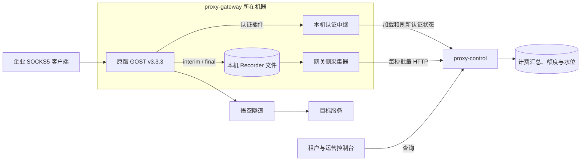

# Proxy 一期技术方案

用量链路由原版 GOST 文件 Recorder、本机采集器和 `proxy-control` 组成。`proxy-control` 在入库时扣减租户流量额度，认证时拦截额度不足的新连接。控制台通过 `proxy-control` 查询用量、额度和运营数据。计费架构参照 new-api：计费汇总实时扣减，会话明细单独保存。开发任务、交付边界和验收口径以一期 Spec 为准。 [一期 Spec](proxy-phase-one-spec.md) · [开发任务](proxy-phase-one-development.md)

## 部署与数据流

- `proxy-gateway` 使用 GOST 的 SOCKS5 TCP CONNECT 及悟空上游配置。平台认证插件校验凭据并返回稳定的 `clientID`，采集时以可信映射确定租户。文件 Recorder 提供计量数据，Observer 提供运行监控。 [悟空接入记录](../../integrations/wukong-socks5-tunnel.md)
- 采集器跟随网关部署，只读本机 Recorder 文件。`proxy-control` 可以部署在其他机器，通过受服务身份认证的 HTTP 接口接收批次。`proxy-control` 负责入库、用量汇总与权限校验。
- API 提取和上游流量查询使用独立的 Mock 适配器。悟空提取服务部署后，客户直连 `IP_List` 中的 SOCKS5 入口，`proxy-control` 再按租户从悟空拉取用量。静态 IP 和计费规则先做领域建模。 [产品对齐](../../product/proxy-product-alignment.md)

使用 SOCKS5 用户名和密码认证时，握手会以明文携带凭据。目标站点的 HTTPS 只保护客户端与目标之间的应用流量。对外开放前，确认首批客户端与网关之间可用的传输保护方式。 [RFC 1929](https://www.rfc-editor.org/rfc/rfc1929.html#section-3)

## 计量、上报与回放

1. **写文件。** GOST 为活跃会话写 `interim`，会话正常结束时写 `final`。每条记录带累计 `inputBytes`、`outputBytes` 和相对同一会话上次 Recorder 写成功的增量。失败的 `interim` 增量会并入该会话下一次成功写入，部分写入可能留下残片并污染下一行，失败的 `final` 不重试。成功建立的会话可计入 SOCKS5 协议字节。采集规则按固定版本验证成功、空连接、上游拒绝、超时和网关策略拒绝，未成功建立的连接不计用量。
2. **读文件并组批。** 采集器每秒检查完整记录，有数据才发，限制批次条数和字节数。同一网关启动代次按文件及记录顺序发送，上一批确认后发送下一批。记录 ID 由网关实例、启动代次、稳定文件标识和记录起始偏移组成，文件轮转及重放时沿用原标识。
3. **提交后确认。** `proxy-control` 在整批事务中扣减额度、累加计费汇总并推进文件水位，事务提交后返回成功。采集器只推进连续已确认的持久化偏移。超时、停机、提交失败或确认丢失时保留源文件并退避重放。已关闭且所有记录均已确认的代次文件可按保留策略清理。
4. **去重与归属。** 控制面按文件水位去重，直接使用 Recorder 增量，不保存会话检查点。增量按本次记录时间计算倍率、分配流量授予，并归入 `Asia/Shanghai` 的分钟和自然日，跨午夜归到后一个采样所在日，回放沿用原采样时间。数据模型见 [ADR 0001](../../adr/0001-usage-data-model.md)。

## 查询、故障与容量

- 租户侧仅可查本租户的上行、下行、合计、计费流量、最近入库时间和剩余额度。运营通过同一聚合按租户、网关实例和时间段查询，按分钟、授予和倍率版本复核，会话与原始采样到网关文件查询。
- 网关侧监控 Recorder 写入错误、未确认积压和磁盘水位。进程外生命周期信号用于发现异常退出。旧代次文件补报并确认完成后，采集器上报仍缺 `final` 的会话，控制面显示可能缺口，缺失字节数记为未知。已写入文件的数据须通过 GOST 进程重启回放验收，宿主机掉电及磁盘丢失另行验证。
- 单实例连接上限取目标环境通过验收的最高已测负载。集中关闭期间需同时验证新连接成功率、成功连接端到端 P99 和 Recorder 记录完整性，并记录文件读齐耗时。具体窗口、发起速率、超时和阈值在压测前约定。 [验收与压测口径](proxy-phase-one-spec.md#验收与测试入口)
- 排查容量瓶颈时，按实例记录有效吞吐、建连速率、最忙 CPU 核、socket 内存和文件描述符余量。按实际源 IP 与上游 IP:port 组合核对出站临时端口，关注热点上游、共享 NAT 和 TIME_WAIT。 [Linux IP sysctl](https://docs.kernel.org/networking/ip-sysctl.html) · [Linux 网络栈扩展](https://docs.kernel.org/networking/scaling.html)

## 已采纳的设计

数据模型、身份机制和接口契约见 [ADR 0001 一期用量计费与凭据数据模型](../../adr/0001-usage-data-model.md)、[ADR 0002 网关服务身份、代理凭据与控制台会话](../../adr/0002-service-and-proxy-identity.md)、[ADR 0003 网关上报、认证准入、用量查询与计费管理接口](../../adr/0003-reporting-and-usage-contracts.md) 和 [ADR 0004 一期计费入库与运营追溯](../../adr/0004-billing-ingestion-and-audit.md)。

认证中继、离线准入与恢复追平见 [ADR 0005 一期代理认证可用性](../../adr/0005-proxy-auth-availability.md)。

## 待定设计

下列事项尚未决定，按阻塞的任务排序。任务编号对应[开发任务](proxy-phase-one-development.md)中 Issue #1 的子任务。决定后把结论并入本文或对应文档，需要记录取舍的写成 [ADR](../../adr/README.md)，并从本表移除。

### 网关切片前确定

#### 文件 Recorder 已确定事项

- **启动路径与稳定标识。** 由网关的进程外启动包装器每次生成新 `boot_id`，独占创建代次目录，验证路径可写后渲染绝对路径 `<spool>/<boot_id>/sessions.jsonl`，用 `gost -C` 启动。每代一个文件，`file_id` 固定为 `sessions`。采集器按 `(gateway_id, boot_id, file_id)` 和字节偏移恢复，文件打开告警纳入就绪检查。
- **文件切换与异常行。** 原版 GOST 的原生轮转可能把 JSON 和 LF 写到两个文件。一期关闭原生轮转，随进程代次换文件，运行期间保持活跃文件路径和内容前缀不变。采集器将以 LF 结束且编码有效的 UTF-8 行原样上报，由控制面在批次事务内隔离无法解析的行。非法 UTF-8 和旧代退出后的无 LF 残尾保留原始字节，采集器保留原偏移并告警，其他代次继续采集。文件清理遵循 [ADR 0004](../../adr/0004-billing-ingestion-and-audit.md#6-recorder-文件追查与保留)。以磁盘水位监控和计划排空、重启限制单文件增长。
- **网关时钟。** 宿主启用时间同步并监控偏移。`time` 按 RFC 3339 解析，接受最多 9 位小数与实际 UTC 偏移，分钟和自然日统一按 `Asia/Shanghai` 归属。 [Recorder 实测与配置](../../integrations/gost-file-recorder.md)

#### 上报与恢复

- **生命周期。** 进程外包装器每 5 秒用 `report` 令牌调用 `POST /v1/reporting/lifecycle`。GOST 退出后先持久化退出时间，再上报。控制面按网关和代次幂等记录，15 秒未收到心跳视为失联。失联与已确认退出分开表示。
- **偏移。** 每个代次的 `confirmed.offset` 与 Recorder 同目录。整批确认后刷新临时文件、原子替换确认位置。确认丢失或落盘前退出时，从旧偏移重发。同盘故障可能同时丢失文件和偏移。
- **开发默认值。** 采样和扫描周期 1 秒，单批 1,000 条或 1 MiB，HTTP 总超时 3 秒，重试退避 1 至 30 秒。磁盘使用率 80% 告警、90% 升级。采集器保留未确认文件并报告积压。
- **悟空冒烟。** 每次 GOST 启动为单入口静态上游配置生成一个 9 位 SID。单租户冒烟完成后，生产多租户的 SID 隔离和入口池健康检查仍需确定。

#### 仍待确定

| 事项 | 需要决定 | 阻塞任务 |
| --- | --- | --- |
| 悟空上游会话 | 生产多租户如何按租户或会话生成 `sid`，以及入口池的健康检查与摘除方式。 [悟空接入记录](../../integrations/wukong-socks5-tunnel.md) | 09 |

### 可并行确定

| 事项 | 需要决定 | 阻塞任务 |
| --- | --- | --- |
| 提取 Mock 契约 | 租户调用统一提取接口的认证方式、请求与响应结构，以及供应商提取和用量查询适配器的接口边界。 | 08 |
| 客户端传输保护 | SOCKS5 用户名密码认证以明文传输凭据。对外开放前确定首批客户端与网关之间的传输保护方式。 | 对外开放 |
| 控制台技术栈 | 见[开发规范的待定项](../../standards/proxy-development-conventions.md#待定项)。 | 05 |
