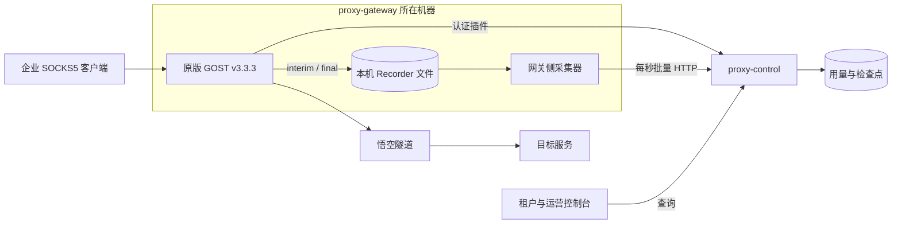

# Proxy 一期技术方案

用量链路由原版 GOST 文件 Recorder、本机采集器和 `proxy-control` 组成。控制台通过 `proxy-control` 查询租户用量和运营明细。开发任务、交付边界和验收口径以一期 Spec 为准。 [一期 Spec](proxy-phase-one-spec.md) · [开发任务](proxy-phase-one-development.md)

## 部署与数据流

- `proxy-gateway` 使用 GOST 的 SOCKS5 TCP CONNECT 及悟空上游配置。平台认证插件校验凭据并返回稳定的 `clientID`，采集时以可信映射确定租户。文件 Recorder 提供计量数据，Observer 提供运行监控。 [悟空接入记录](../../integrations/wukong-socks5-tunnel.md)
- 采集器跟随网关部署，只读本机 Recorder 文件。`proxy-control` 可以部署在其他机器，通过受服务身份认证的 HTTP 接口接收批次。`proxy-control` 负责入库、用量汇总与权限校验。
- API 提取和上游流量查询使用独立的 Mock 适配器。悟空提取服务部署后，客户直连 `IP_List` 中的 SOCKS5 入口，`proxy-control` 再按租户从悟空拉取用量。静态 IP 和计费规则先做领域建模。 [产品对齐](../../product/proxy-product-alignment.md)

使用 SOCKS5 用户名和密码认证时，握手会以明文携带凭据。目标站点的 HTTPS 只保护客户端与目标之间的应用流量。对外开放前，确认首批客户端与网关之间可用的传输保护方式。 [RFC 1929](https://www.rfc-editor.org/rfc/rfc1929.html#section-3)

## 计量、上报与回放

1. **写文件。** GOST 为活跃会话写 `interim`，会话正常结束时写 `final`。原始快照保留累计 `inputBytes`、`outputBytes`。成功建立的会话可计入 SOCKS5 协议字节。采集规则按固定版本验证成功、空连接、上游拒绝、超时和网关策略拒绝，未成功建立的连接不计用量。
2. **读文件并组批。** 采集器每秒检查完整记录，有数据才发，限制批次条数和字节数。同一网关启动代次按文件及记录顺序发送，上一批确认后发送下一批。记录 ID 由网关实例、启动代次、稳定文件标识和记录起始偏移组成，文件轮转及重放时沿用原标识。
3. **提交后确认。** `proxy-control` 在整批事务中保存原始记录、检查点与认可增量，事务提交后返回成功。采集器只推进连续已确认的持久化偏移。超时、停机、提交失败或确认丢失时保留源文件并退避重放。已关闭且所有记录均已确认的轮转文件可按保留策略清理。
4. **去重与归日。** 控制面按记录 ID 去重，按 `(gateway_id, boot_id, sessionID)` 保存会话累计检查点。相同累计的增量为零，累计增长取差值，`recordIndex` 用于追溯。零增量 `final` 仍可关闭会话。增量按本次 Recorder 记录时间归入 `Asia/Shanghai` 自然日，跨午夜归到后一个采样所在日，回放沿用原采样时间。

## 查询、故障与容量

- 租户侧仅可查本租户的上行、下行、合计和最近入库时间。运营通过同一聚合查询，能追到原始采样、网关实例、启动代次、会话和认可增量。原始明细仅保留计量和追溯所需字段。
- 网关侧监控 Recorder 写入错误、未确认积压和磁盘水位。进程外生命周期信号用于发现异常退出。旧代次文件补报并确认完成后，仍缺 `final` 的会话显示可能缺口，缺失字节数记为未知。已写入文件的数据须通过 GOST 进程重启回放验收，宿主机掉电及磁盘丢失另行验证。
- 单实例连接上限取目标环境通过验收的最高已测负载。集中关闭期间需同时验证新连接成功率、成功连接端到端 P99 和 Recorder 记录完整性，并记录文件读齐耗时。具体窗口、发起速率、超时和阈值在压测前约定。 [验收与压测口径](proxy-phase-one-spec.md#验收与测试入口)
- 排查容量瓶颈时，按实例记录有效吞吐、建连速率、最忙 CPU 核、socket 内存和文件描述符余量。按实际源 IP 与上游 IP:port 组合核对出站临时端口，关注热点上游、共享 NAT 和 TIME_WAIT。 [Linux IP sysctl](https://docs.kernel.org/networking/ip-sysctl.html) · [Linux 网络栈扩展](https://docs.kernel.org/networking/scaling.html)

## 待定设计

下列事项尚未决定，按阻塞的任务排序。任务编号对应[开发任务](proxy-phase-one-development.md)中 Issue #1 的子任务。决定后把结论并入本文或对应文档，并从本表移除。

### 开工前确定

| 事项 | 需要决定 | 阻塞任务 |
| --- | --- | --- |
| 数据模型 | 原始记录、会话检查点、认可增量、隔离记录、可能缺口、网关实例与启动代次、租户、成员、代理凭据、`clientID` 与租户映射的表结构和约束。日汇总在查询时计算还是预聚合，最近入库时间取自哪里。 | 02、03、06 |
| 身份机制 | 网关服务身份的认证方式，例如逐实例令牌或 mTLS。控制台会话令牌的形式、过期和吊销。GOST 认证插件调用控制面的认证方式。成员、停用状态和多租户成员关系存入数据库，替代配置文件中的静态用户。 | 01、02、03 |
| 接口契约 | `reporting.proto` 的批次字段、可重试与永久拒绝的状态码、回放完成通知格式。`usage.proto` 的租户查询与运营明细分页参数。 | 03、04、06 |

### 网关切片前确定

| 事项 | 需要决定 | 阻塞任务 |
| --- | --- | --- |
| 启动代次与生命周期 | 原版 GOST 不生成启动代次。确定由哪个进程外组件生成代次标识、渲染 Recorder 文件路径并启动 GOST，以及该组件如何上报心跳或退出事件，使无流量时也能发现异常退出。 | 04、07 |
| 文件轮转与稳定标识 | 核实 GOST `v3.3.3` 文件 Recorder 的轮转方式和改名规则。确定文件改名后稳定标识的来源，以及采集器如何跟踪轮转中的文件。 | 04、07 |
| 采集器偏移持久化 | 偏移文件的位置、写入与 fsync 方式，以及与 Recorder 文件同盘时的故障边界。 | 04、07 |
| 悟空上游会话 | 网关如何按租户或会话生成悟空用户名中的 `sid`。原版 GOST 的静态上游配置使所有租户共用同一用户名和会话粘性。另定入口池的健康检查与摘除方式，实测部分入口持续超时。 [悟空接入记录](../../integrations/wukong-socks5-tunnel.md) | 04、09 |
| 认证可用性 | 认证服务异常时拒绝新认证，控制面停机即阻断新连接。确定是否缓存认证结果、缓存时长，以及凭据停用的生效时限。 | 02、04、09 |
| 网关时钟 | 跨日归属依赖网关 Recorder 时间。确定网关时间同步要求，以及 Recorder 时间戳的格式和时区。 | 04 |
| 开发默认参数 | GOST 采样周期、批次条数和字节上限、请求超时、退避策略、文件保留期和磁盘水位阈值的开发默认值。正式取值仍按[部署参数](proxy-phase-one-spec.md#部署参数与范围)上线前确定。 | 04、07 |

### 可并行确定

| 事项 | 需要决定 | 阻塞任务 |
| --- | --- | --- |
| 提取 Mock 契约 | 租户调用统一提取接口的认证方式、请求与响应结构，以及供应商提取和用量查询适配器的接口边界。 | 08 |
| 客户端传输保护 | SOCKS5 用户名密码认证以明文传输凭据。对外开放前确定首批客户端与网关之间的传输保护方式。 | 对外开放 |
| 控制台技术栈 | 见[开发规范的待定项](../../standards/proxy-development-conventions.md#待定项)。 | 05 |
