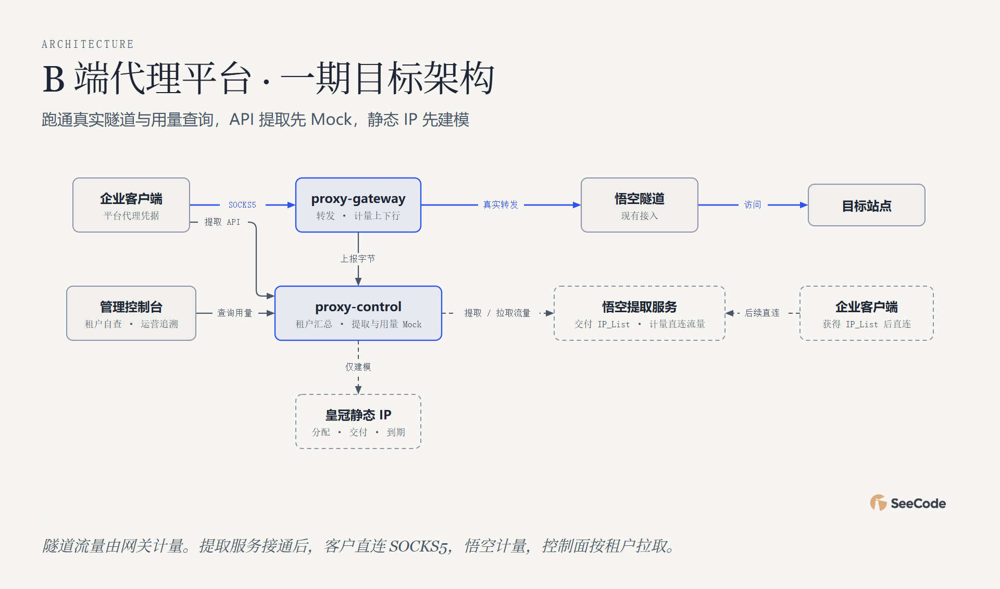

# Proxy 一期｜交付、验收与悟空联调

Proxy 一期先跑通企业客户使用悟空动态 IP 隧道、平台上报流量、客户和运营查询用量的完整链路。隧道和 API 提取都按流量计费。隧道流量由 `proxy-gateway` 计量，API 提取后的直连流量由悟空计量，再由 `proxy-control` 按租户拉取。API 提取及流量查询先用 Mock，皇冠静态 IP 先建模，定价、扣款和出账另行排期。

**用三个用户故事验收**

1. **租户自查。** 两个测试租户分别使用自己的凭据，经 `proxy-gateway` 和悟空隧道访问目标。网关计量并上报上下行字节。两个租户登录控制台后，各自只能看到自己的流量，可按天查看上行、下行、合计和更新时间。
2. **运营核查。** 运营能按租户和时间查到与租户侧一致的隧道用量，并追溯到 `proxy-gateway` 的上报记录。
3. **租户提取代理。** 调用平台 API 可拿到模拟 `IP_List`，平台能拉取模拟流量并归到正确租户。悟空服务接入后，客户直连列表中的 SOCKS5 入口，由悟空记录实际流量。

**项目约束，需要推动悟空提供**

- **API提取服务部署。** 请给出提取 API 文档和请求、响应样例，说明 `IP_List` 的连接参数、有效期、部分成功和重试行为。
- **按租户查询 API 提取流量。** 提供查询 API 文档和两个租户的响应样例，说明通过什么标识区分租户、怎样区分两种接入方式的流量，以及时间窗口、单位、更新延迟和累计或增量口径。
