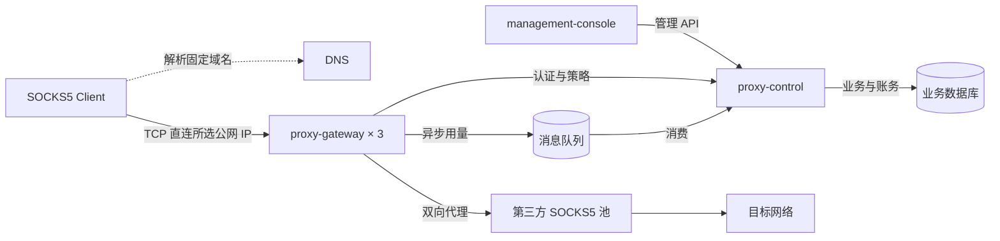
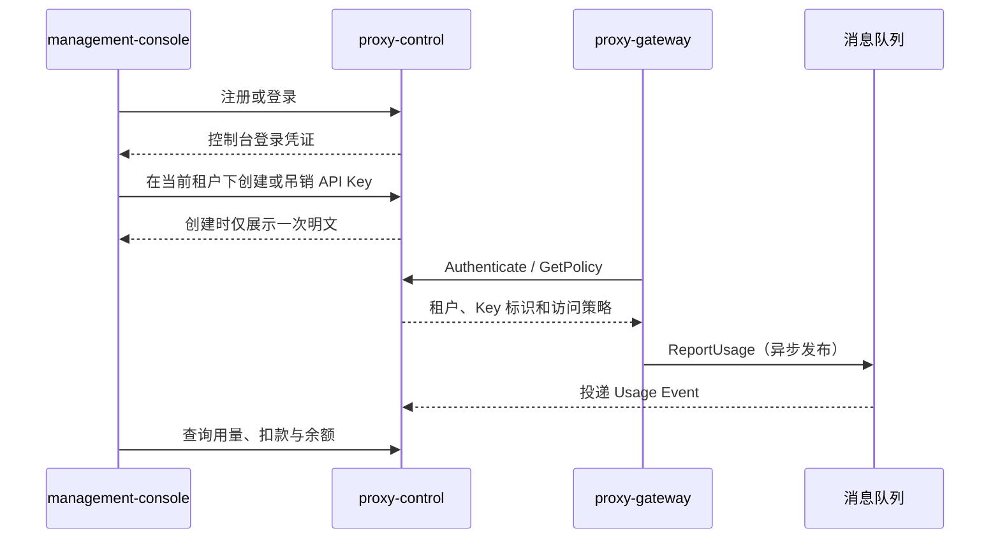
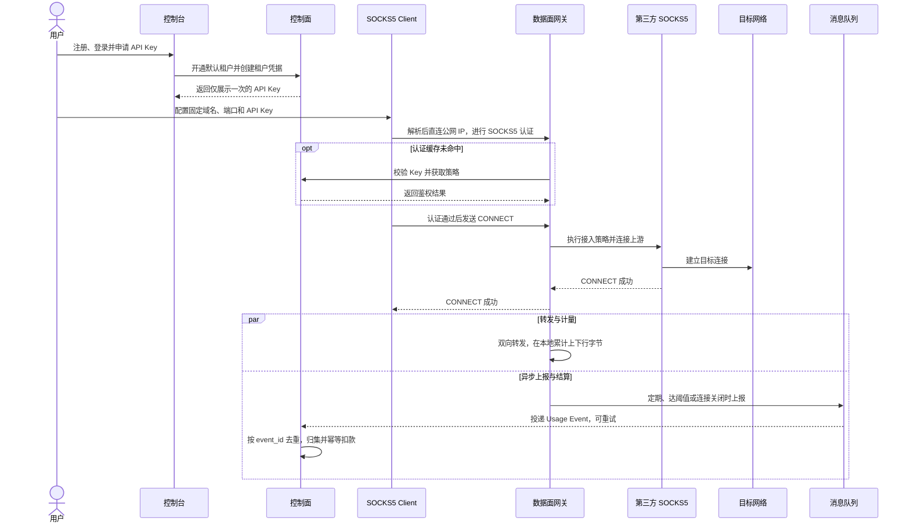
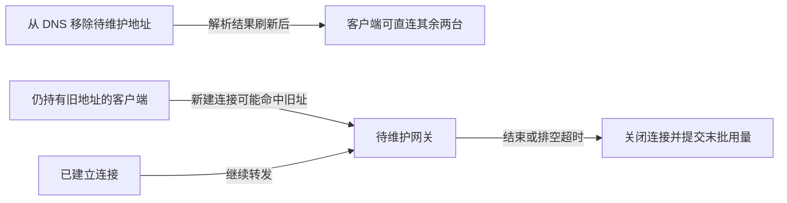

# 多租户 SOCKS5 代理平台 · 一期方案讨论

**一期目标**　新用户能自助开通代理，通过第三方 SOCKS5 出口访问目标网络，并在控制台查到对应租户的用量、扣款和余额。

> 作为新用户，我希望登录后创建一个 API Key，把它填入现有 SOCKS5 客户端，连通目标站点，并知道这次使用花了多少钱。

## 01 技术架构

一个大仓，三个部署单元。控制台负责操作和展示，控制面负责业务规则，数据面负责处理代理连接。

`proxy-control` 以模块化单体部署，内部管理身份、租户、凭据、代理资源与策略、用量、计费和账户。

固定域名的 DNS 记录返回三台 `proxy-gateway` 的公网 IP。标准 SOCKS5 客户端配置域名和统一端口，从解析结果中选一个地址建立 TCP 连接。DNS 只负责解析，代理流量由网关直接收发。建议三台网关共享 12 台第三方 SOCKS5 上游，每条会话在 CONNECT 时选择一个上游。

## 02 服务交互与凭据

登录凭证用于操作控制台。API Key 归属租户，用于建立代理连接，控制面只保存校验摘要。新连接鉴权使用有时效的缓存，吊销生效时间和在途连接处置待定。

## 03 从开通到扣费

连接存续期间，转发和用量上报可并行。用量事件记录字节数，计费记录对应金额，账务流水记录实际扣款。相同事件重复投递时只扣一次。鉴权失败时结束握手，上游连接失败时返回 SOCKS5 失败响应。

## 04 DNS 摘流与网关排空

计划维护时先从 DNS 移除待维护地址，观察旧地址的新建连接下降，再让网关停止接入并排空存量会话。旧解析可能仍被缓存，客户端是否尝试其他地址取决于其实现。DNS 变更不会迁移已建立的 TCP 连接。 [DNS 缓存与解析](https://www.rfc-editor.org/rfc/rfc1035.html#section-2.1)

## 会上拍板

| 议题 | 建议与待确认项 |
| --- | --- |
| 一期范围 | 跑通 TCP CONNECT、第三方上游池和用量扣费闭环。确认首批客户端的 SOCKS5 凭据填法、传输保护和多地址重试行为。 |
| 公网接入 | 验证 DNS 缓存、流量偏斜、旧地址命中和节点故障恢复，并确认剩余两台网关能否承载业务峰值。 |
| 扣费与超额 | 建议小批量结算，余额触线后限制新连接。确认单价、可接受的超额上限及在途连接处置。若要求严格额度上限，需要跨网关额度租约。 |
| 上线验收 | 用租户 A 跑通开通、访问和查账，确认租户 B 无法访问 A 的数据。重放同一用量事件验证只扣一次，模拟网关异常退出验证未上报用量的补偿边界。 |

## 详细讨论

- [领域模型、用户故事与状态机](proxy-domain-model.md)
- [一期架构决策与取舍](proxy-architecture-decisions.md)
- [单节点容量、技术选型与 Benchmark](proxy-capacity-benchmark.md)

讨论来源：[梳理多租户代理架构](chatgpt-conversation://6af07b80-636c-83e9-ba22-5752b82ad7ec)
