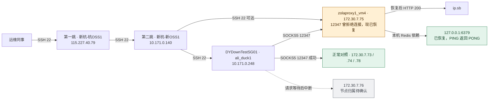

# 2026-11-12 悟空 SOCKS5 节点 .75 故障与恢复

**状态：已恢复。** `172.30.7.75:12347` 曾立即拒绝 TCP 连接。主机可通过 SSH 登录，代理进程 `zNode` 已被内核 OOM killer 杀掉。本机 Redis 也曾被 OOM killer 杀掉。依次恢复 Redis 和 `zNode` 后，从原测试机 `DYDownTestSG01` 验证了 SOCKS5 出站。整机内存耗尽的原因仍待查。

## 现象与影响

在 `DYDownTestSG01` 的 `/opt/seedpipe` 下，用相同代理账号、SID 和目标 `http://ip.sb` 测试多个入口。

| 入口 | 初始现象 |
| --- | --- |
| `172.30.7.75:12347` | `curl: (7)`，约 4 ms 内连接失败。第二跳复测明确返回 `Connection refused`。 |
| `172.30.7.76:12347` | 请求等待期间被手动中断。第二跳复测时，SSH 和代理端口均超时。 |
| `172.30.7.73:12347`、`172.30.7.74:12347`、`172.30.7.78:12347` | 均成功返回出口 IP。 |

已观察到的影响是经 `.75` 的测试请求失败。生产请求受影响的数量和时间范围未核实。

## 网络拓扑与现场入口



SSH 路径用于登录和排查。出站验收在测试机内发起，实际连接 `172.30.7.75:12347`。拓扑只覆盖本次涉及的节点和连接。

| 用途 | SSH 入口 | 认证来源 |
| --- | --- | --- |
| 第一跳 | `root@115.227.40.79:22` | 团队授权的第一跳密钥。Windows 排查环境使用 `115.227.40.79_key.pem`。 |
| 第二跳 | `root@10.171.0.140:22` | 团队授权的 `sg_key_new.pem`。 |
| 原测试机 | `root@10.171.0.248:22` | 团队授权的 `sg_key_new.pem`。登录后用 `hostname -s` 核对 `DYDownTestSG01`。 |
| 故障节点 | `root@172.30.7.75:22` | 从团队授权渠道取得目标机 SSH 凭据。登录后用 `hostname -s` 核对 `relay-154.81.157.75`。清单登记公网地址为 `154.81.157.75`。 |

OpenSSH 配置示例。将 `IdentityFile` 改为本机授权密钥的实际路径，首次连接前向运维核对主机指纹。

```sshconfig
Host wk-jump-1
    HostName 115.227.40.79
    User root
    IdentityFile ~/.pem/115.227.40.79_key.pem
    IdentitiesOnly yes

Host wk-jump-2
    HostName 10.171.0.140
    User root
    IdentityFile ~/.pem/sg_key_new.pem
    IdentitiesOnly yes
    ProxyJump wk-jump-1

Host wk-test-sg01
    HostName 10.171.0.248
    User root
    IdentityFile ~/.pem/sg_key_new.pem
    IdentitiesOnly yes
    ProxyJump wk-jump-2

Host wk-proxy-75
    HostName 172.30.7.75
    User root
    ProxyJump wk-jump-2
```

保存到本机 SSH 配置后，用 `ssh wk-jump-2`、`ssh wk-test-sg01` 或 `ssh wk-proxy-75` 进入对应节点。

## 排查与证据

| 检查 | 观察与判断 |
| --- | --- |
| 从第二跳对照 TCP 端口 | `.75:22` 可达，`.75:12347` 明确拒绝连接。同组 `.74` 的两个端口都可达。 |
| 在 `.75` 和 `.74` 查看监听与进程 | `.75` 无 `zNode` 进程，也无 `12347` 监听。`.74` 的 `12347` 由 `zNode` 监听。 |
| 查看 `.75` 的内核日志 | Redis 和 `zNode` 分别在两次 OOM 中被杀。第二次为全局 OOM，当时约 6 GiB swap 仅剩 84 KiB。 |
| 核对 systemd 管理范围 | `zNode.service` 配置为 `Restart=on-failure`，排查时为 `inactive (dead)`。内核日志显示被杀的 `zNode` 属于 `session-32.scope`，因此该 unit 的重启策略没有覆盖它。 |
| 核对 Redis 依赖 | `.75` 上无 Redis 进程，`6379` 无监听。`zNode` 日志多次记录 `dial tcp 127.0.0.1:6379: connect: connection refused`。 |

关键内核日志，时间已换算为北京时间（UTC+8）。主机原始日志使用 UTC−5。

| 北京时间 | 内核日志摘要 |
| --- | --- |
| 11 月 12 日 02:56:34 | `Out of memory: Killed process 273244 (redis-server)` |
| 11 月 12 日 12:00:43 | `global_oom,task_memcg=/user.slice/user-0.slice/session-32.scope,task=zNode,pid=278016` |
| 11 月 12 日 12:00:43 | `Out of memory: Killed process 278016 (zNode)` |

在第二跳复测 TCP。示例使用 Bash，每次连接最多等待 3 秒。

```bash
for node in 73 74 75 76 78; do
  for port in 22 12347; do
    printf '%s:%s ' "172.30.7.$node" "$port"
    timeout 3 bash -c 'exec 3<>"/dev/tcp/$1/$2"' _ "172.30.7.$node" "$port"
    printf 'exit=%s\n' "$?"
  done
done
```

登录故障节点后复查监听、进程与历史日志。这里的 `--since` 和 `--until` 使用该主机当时的本地时间。

```bash
hostname -s
ss -lntp '( sport = :12347 or sport = :6379 )'
ps -C zNode,redis-server -o pid,ppid,lstart,comm
systemctl show redis.service zNode.service \
  -p ActiveState -p SubState -p MainPID -p Restart -p NRestarts
journalctl -k --since '2026-11-11 13:50:00' --until '2026-11-11 23:05:00' \
  --no-pager -g 'oom-kill:|Out of memory|Free swap'
```

## 恢复与验收

在 `.75` 上执行以下步骤。Redis 返回 `PONG` 后才继续启动 `zNode`。

```bash
systemctl start redis.service
systemctl is-active redis.service
redis-cli -h 127.0.0.1 -p 6379 PING

# Redis 返回 PONG 后执行以下命令。
systemctl start zNode.service
systemctl show zNode.service -p ActiveState -p SubState -p MainPID
ss -lntp '( sport = :12347 )'
```

实测 Redis 状态为 `active`，`PING` 返回 `PONG`。`zNode.service` 为 `active (running)`，`MainPID=3972057`，同一进程监听 `*:12347`。

从 `DYDownTestSG01` 验证原请求。下例在 Bash 中交互读取获授权的代理用户名和密码，并通过标准输入传给 curl。

```bash
hostname -s
read -r -p 'SOCKS5 完整用户名: ' WK_PROXY_USER
read -r -s -p 'SOCKS5 密码: ' WK_PROXY_PASSWORD
printf '\n'
printf 'proxy-user = "%s:%s"\n' "$WK_PROXY_USER" "$WK_PROXY_PASSWORD" |
  curl -q --config - --noproxy '' --proxy socks5h://172.30.7.75:12347 \
    --connect-timeout 8 --max-time 20 -fsS \
    -w '\nHTTP=%{http_code} peer=%{remote_ip} tcp=%{time_connect}s total=%{time_total}s\n' \
    http://ip.sb
unset WK_PROXY_USER WK_PROXY_PASSWORD
```

本次复测得到 `HTTP=200`、`peer=172.30.7.75`、出口 IP `103.179.225.56`，总耗时约 `0.31s`。验收时核对代理入口、HTTP 响应与出口 IP。动态出口可能变化。

代理账号格式、SID 和接入约定见[悟空 SOCKS5 隧道转发接入](../../integrations/wukong-socks5-tunnel.md)。

## 未结项

- **整机 OOM 的原因。** 已确认全局 OOM 和两个被杀的进程。仍需结合故障前的主机内存、swap、进程或 cgroup 指标，确认内存由谁占用、从何时开始增长。
- **`.76` 的归属。** 从第二跳访问 `172.30.7.76` 的 SSH 和代理端口均超时，本次使用的节点清单无该地址。先向节点维护方确认地址分配和投产状态，再判断是否存在第二个故障。

## 可复用判断

- 同一个测试源、目标和代理账号下，对照健康入口。TCP 立即拒绝时，优先查目标主机监听和进程。TCP 超时时，保留测试源与端口结果，结合节点清单确认目标是否在用。
- SSH 可登录只能证明管理路径可用。代理恢复需要从原客户端用真实 SOCKS5 请求验收，核对连到的入口及目标响应。
- 看到 `Restart=on-failure` 后，继续用进程 cgroup、systemd 的 `MainPID` 和监听 PID 核对实际管理关系。
- 区分服务中断的直接原因与上游触发因素。OOM 日志可证明进程被内核杀掉，识别内存耗尽的来源还需要故障前的指标。
- 有本机依赖的代理，按依赖可用、代理监听、客户端出站三个阶段验收。每一步记录实际结果。
