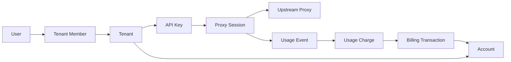
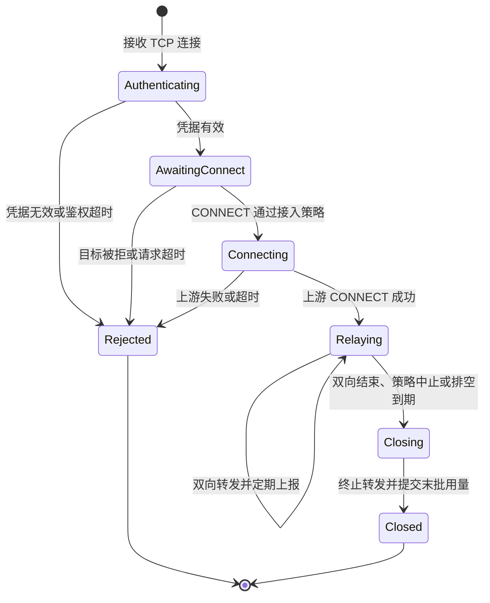
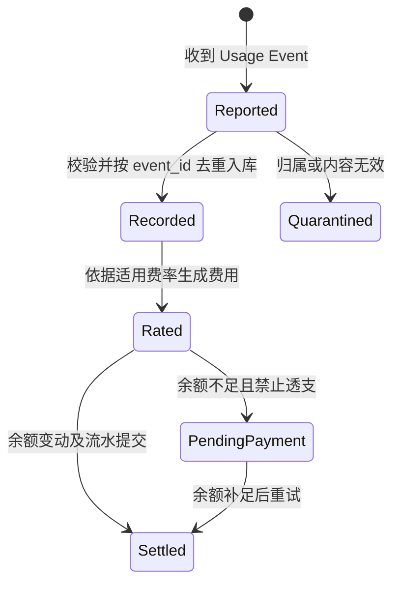

# 领域模型、用户故事与状态机

本文细化[一期方案](multi-tenant-proxy-architecture.md)的业务语义。术语以[仓库术语表](../GLOSSARY.md)为准。状态名用于讨论，数据库结构与接口字段后续设计。

## 领域边界

| 领域 | 核心对象 | 归属与职责 |
| --- | --- | --- |
| 身份与租户 | User、Tenant、Tenant Member | `proxy-control` 认证控制台用户，按成员权限授权租户操作。 |
| 凭据与策略 | API Key、Access Policy、Traffic Quota | `proxy-control` 管理代理凭据与访问规则，`proxy-gateway` 对连接执行规则。 |
| 代理执行 | Proxy Session、Upstream Proxy | `proxy-control` 管理上游配置，`proxy-gateway` 建立上游连接、转发并维护在途会话。 |
| 用量与账务 | Usage Event、Usage Charge、Account、Billing Transaction | `proxy-gateway` 计量并发布事件，`proxy-control` 核算用量、计算费用并记录扣款。 |

- **租户隔离。** 一期注册时开通默认租户。控制台的租户权限来自 Tenant Member，数据面的租户归属来自 API Key 的鉴权结果。换 Key 或更换网关实例后，用量仍按原连接绑定的租户归集。
- **用量口径。** 建议以每个方向成功写入对端 socket 的代理负载字节为准，排除 SOCKS5 握手和 TCP/IP 开销。这个口径计量网关转发，无法证明目标应用已收到。断开前的部分写入按实际完成字节计。
- **事件与金额。** 每个 Usage Event 代表一个互不重叠的计量增量，重试沿用同一 `event_id`。用量与费用按计量发生时适用的费率核算，扣款完成后才产生资金变动流水。资金余额与流量额度各自独立。

## 用户故事与验收

| 用户故事 | 可观察的验收 |
| --- | --- |
| 作为新用户，我要注册、登录并为客户端生成一把 Key。 | 能在自己的租户创建 Key，完整凭据只在创建时展示。其他租户无法读写该凭据。 |
| 作为客户端用户，我要通过第三方 SOCKS5 出口访问目标。 | 有效 Key 完成认证，上游建立目标连接后才收到 CONNECT 成功。无效 Key 或上游拨号失败时，客户端收到相应阶段的失败响应。 |
| 作为租户管理员，我要核对用了多少流量、扣了多少钱。 | 同一事件重试可重复消费，用量和账务只入账一次。仍在转发的会话可产生周期性用量。 |
| 作为租户管理员，我要吊销一把泄露的 Key。 | 新连接在约定时间内被拒绝，已有会话按约定继续或终止，其他 Key 可继续使用。 |
| 作为运营方，我要确认租户到达预算后会停止新增消费。 | 余额触线后新连接在约定时间内被拦截。在途会话的超额上限取决于会议选定的策略。 |

## 代理会话状态机

鉴权通过时绑定租户和 Key，进入 `Relaying` 后才开始计费字节计量。正常 TCP 半关闭只结束一个方向，另一方向可继续到自然结束或超时。网关异常退出可能跳过 `Closing`，可恢复范围取决于用量持久化边界。

## 用量到扣款状态机

这是按事件跟踪的简化状态。重复投递读取已有处理结果，避免再生成费用或再扣一次。费用结清、余额更新和流水入账须有同一个事务边界。若产品允许透支，应另外确定欠费状态及恢复条件。
